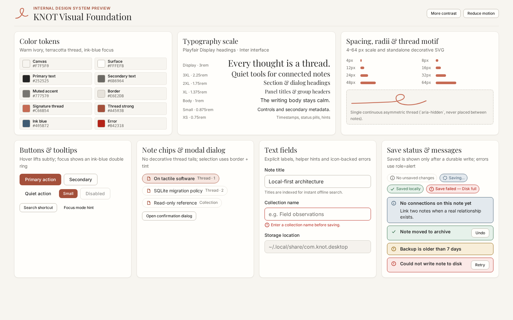
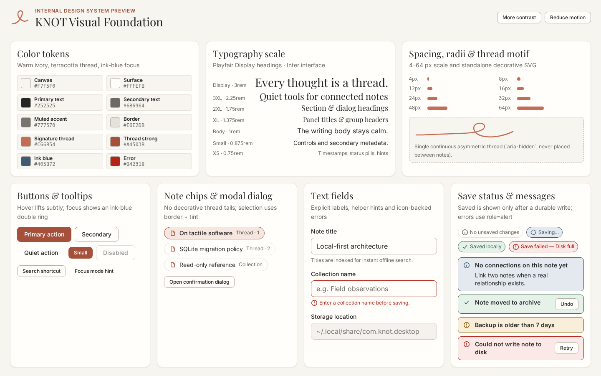

# Issue #2 verification: KNOT design system

This document records the verification of Issue #2 (design tokens, typography,
continuous thread motif, shared UI primitives and the internal design preview)
against the [design contract](../design/knot/README.md), the
[technical architecture](../architecture/TECH-STACK.md) and the
[module boundaries](../../src/README.md).

## Acceptance criteria

| Criterion | Implementation and verification |
| --- | --- |
| CSS tokens for Ivory, Terracotta, Ink Blue, text, border, focus, error | Defined in [`src/shared/styles/tokens.css`](../../src/shared/styles/tokens.css). Contrast ratios of text, control and state pairs are enforced by [`tests/design-tokens.test.ts`](../../tests/design-tokens.test.ts). Small secondary text uses `#6B6964` (5.03:1 on canvas) and small terracotta text / primary fills use `#A4503B` (5.09:1 on canvas, 5.54:1 with white text), keeping `#777570` and `#C66B54` for large text, strokes and fills. |
| Typography scale, spacing, elevation and radii | `rem`-based type scale (`0.75rem`–`3rem`) with bundled local `@fontsource-variable/playfair-display` and `@fontsource-variable/inter` (SIL OFL 1.1, no remote requests), `4/8/12/16/24/32/48/64` px spacing scale, `sm`/`md`/`lg`/`pill` radii and warm elevations `0`–`3`. |
| Continuous asymmetric KNOT motif as SVG | [`KnotMotif`](../../src/shared/ui/KnotMotif/KnotMotif.tsx) draws a single open `<path>` in `mark` and `flourish` variants. Hidden from assistive technology (`aria-hidden="true"`, `focusable="false"`, `pointer-events: none`) unless an explicit `label` is passed. |
| Buttons, inputs, note chips, panels, dialogs, tooltips and status components | Implemented under [`src/shared/ui/`](../../src/shared/ui/index.ts): `Button`, `TextField`, `NoteChip`, `Panel`, `Dialog`, `Tooltip`, `SaveStatus` and `StatusMessage`, each with scoped CSS and colocated Vitest + Testing Library tests. |
| Contrast variants and reduced motion out of the box | `prefers-contrast: more`, `forced-colors: active` and `prefers-reduced-motion: reduce` media queries in `tokens.css` and `KnotMotif.css`, mirrored by `data-knot-contrast="more"` and `data-knot-motion="reduce"` on `<html>` for interactive inspection in the design preview. |
| All components visible in an internal design preview | Mounted by [`/design-preview.html`](../../design-preview.html) via [`src/design-preview/`](../../src/design-preview/DesignPreview.tsx). The production entry [`/index.html`](../../index.html) does not import or link to the preview; [`tests/ui/launch.spec.ts`](../../tests/ui/launch.spec.ts) guards this boundary. |
| Consistent appearance at 1440×900 and 1600×1000 | [`tests/ui/design-preview.spec.ts`](../../tests/ui/design-preview.spec.ts) runs against both Playwright projects (`1600×1000` and `1440×900`), verifying that all seven sections fit without horizontal or vertical overflow and with zero axe WCAG 2.1 A/AA violations in default, more-contrast and open-dialog states. |
| Focus state clearly distinct from hover | Hover uses a terracotta border shift (`#C66B54`) and a 1 px lift; `:focus-visible` renders an immediate ink-blue double ring (`#405B72` outside a 2 px surface gap). Verified programmatically in `design-preview.spec.ts`. |
| Decorative threads do not suggest false semantic links | `KnotMotif` has no endpoint props, cannot connect elements, and is excluded from the note-chip panel (`design-preview.spec.ts` asserts zero `.knot-motif` elements inside the note-chip section). `NoteChip` renders no decorative thread tails. |

## Screenshots for review

Captured from the built frontend via `pnpm test:ui` at 100% text size and
device scale 1 in Chromium:

| 1600×1000 | 1440×900 |
| --- | --- |
|  |  |

## Verification summary and remaining native review

- **Unit and component tests (`pnpm test`):** 43 passed across 10 test files
  (5 Linux prerequisite CLI tests, 11 token contrast checks, 27 component tests).
- **UI and accessibility tests (`pnpm test:ui`):** 20 passed across the
  `1600×1000` and `1440×900` Chromium projects (launch view + design preview,
  including axe WCAG 2.1 A/AA checks, focus-vs-hover verification, decorative
  motif isolation and reduced-motion checks).
- **Dependency audit (`pnpm audit`):** 0 known vulnerabilities. Direct license
  metadata for the bundled fonts (OFL-1.1) and DOM test libraries (MIT) is
  recorded in [`PORTABILITY.md`](PORTABILITY.md).
- **Remaining manual / native review on the developer Linux host:** opening
  `design-preview.html` in WebKitGTK / browser with Orca and KDE Plasma scaling
  (125% / 150%) remains part of the human review before merge.
