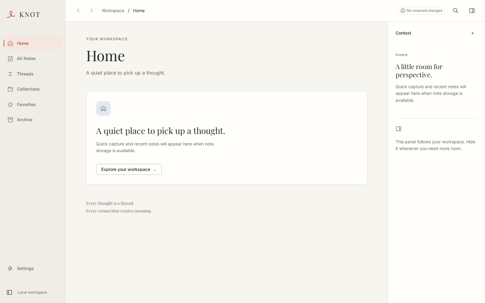
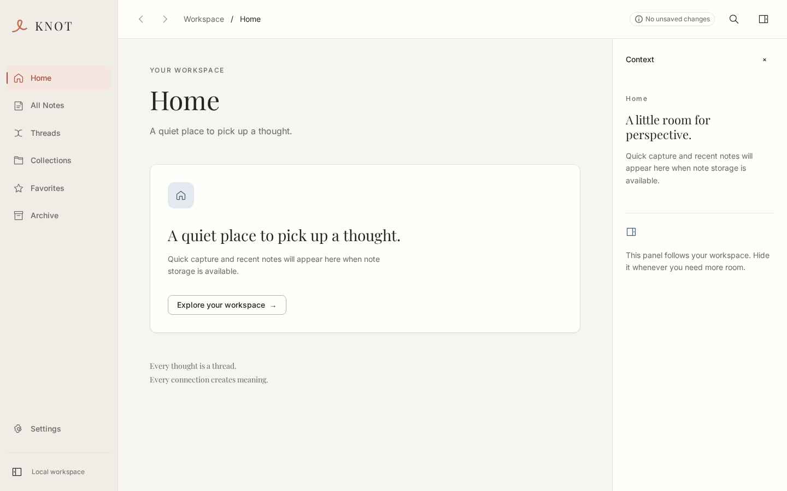
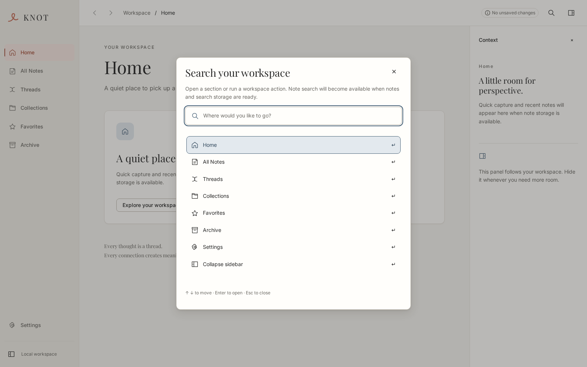
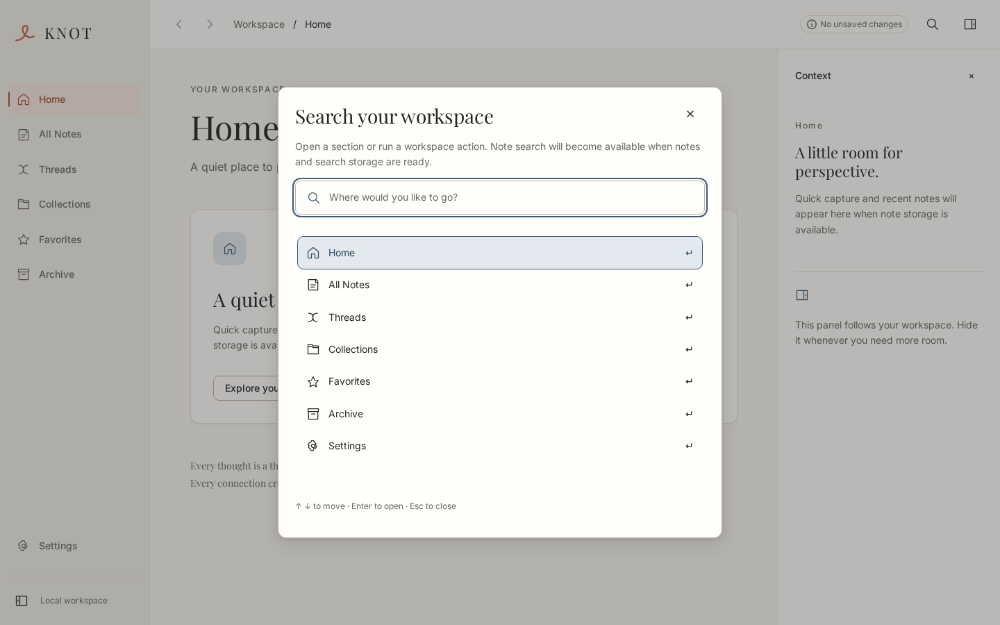

# Issue #3 verification: desktop shell

The shell implements the three workspace regions from the
[design contract](../design/knot/README.md). It uses the existing design tokens,
native window decorations and minimum content size of 960×640. The seven areas
are navigation destinations with honest foundation views; note storage, an
editor and full-text search remain future features.

## Architecture and state

- `NavigationController` owns typed hash destinations and browser-history
  integration. Back/Forward are bounded to the current application session;
  reloading starts a new boundary at the current destination. Unknown hashes
  normalize to Home. A new destination after Back discards Forward history.
- `ShellPreferencesService` receives a `ShellPreferencesStorage` interface.
  The concrete browser adapter acquires local storage lazily. Version 1 stores
  only `sidebarCollapsed` and `contextVisible` under
  `knot.shell.preferences.v1`. Invalid data falls back to expanded/open defaults;
  inaccessible storage or failed writes produce a visible status message while
  keeping session controls usable. A later successful change clears the warning.
- Below 1200 px the sidebar temporarily becomes a 68 px rail. This does not
  overwrite the persisted wide-window preference. The context panel is 320 px;
  main content grows when it closes. Very narrow effective viewports stack the
  inspector below the main area. Content and context have their own scroll areas.
- `DesktopShell` composes focused sidebar, toolbar, overview and palette
  components. The optional `ShellDocument` contract provides a title, externally
  confirmed save status and an editor focus callback. Document and context slots
  remain mounted through panel, breakpoint and Focus Mode changes. The shell
  does not read, mutate or persist document content. The editor owns restoring
  its selection when its `focusEditor` callback is called.
- Focus Mode is offered only with a document contract. It hides shell regions
  without changing stored panel preferences. Exit and Escape restore the same
  editor. Escape closes a nested palette first. The launch app has no editor, so
  it has no Focus Mode control. Its save indicator remains neutral.

## Keyboard and accessibility

| Action | Interaction |
| --- | --- |
| Skip navigation | First Tab reveals **Skip to content**; Enter focuses the view heading. |
| Change area | Tab to the navigation link, then Enter; focus moves to the destination heading. |
| Back / Forward | Toolbar buttons or Alt+Left / Alt+Right; unavailable actions are disabled. |
| Search shell actions | Ctrl+K / Cmd+K or **Search workspace**. These are app-local shortcuts. |
| Palette selection | Type to filter, Up/Down to move, Home/End to select endpoints, Enter to run. |
| Close palette | Escape or Close; restores prior focus. Navigation actions focus their destination. |
| Toggle panels | Named buttons; the inspector close button returns focus to its toolbar toggle. |
| Exit Focus Mode | Visible **Exit Focus Mode** button or unconsumed Escape; restores editor focus. |

The palette exposes a labelled combobox and listbox, an explicit empty-result
state, native modal background inertness and bounded Tab/Shift+Tab navigation.
The current area has `aria-current`; icon controls have accessible names.
Reduced-motion, increased-contrast and forced-color tokens remain supported.
Focus is visibly distinct from hover.

## Automated verification

Run from a prepared host:

```sh
pnpm check
pnpm test
pnpm test:ui
pnpm build --no-bundle -- --locked
```

When invoking the host toolchain from the Codex Flatpak environment, prefix a
command with `flatpak-spawn --host --directory=/home/vkunasegar/projects/Knot
sh -lc '…'`.

- **TypeScript:** passed.
- **Vitest:** 63 tests passed across 16 files. Includes navigation history,
  serialized rapid history actions, settings reload/validation/read/write failure, sidebar responsiveness, panel
  focus return and preservation of a live document instance/selection.
- **Playwright:** 38 tests passed across both 1600×1000 and 1440×900 projects.
  Includes all navigation destinations, app history, direct/invalid routes,
  preference persistence and failure, Ctrl/Cmd palette entry, modal focus,
  empty results, axe WCAG 2.1 A/AA, forced colors and reduced motion. Resize
  checks cover 1024 px and 960×640; 200% text remains usable.
- **Real browser document contract:** a test-only controlled textarea proves
  unchanged content, DOM identity, selection and scroll through panel changes,
  resize, Focus Mode and nested modal dismissal. Its save status is injected.
  `pnpm test:ui` builds with Vite mode `test`; its extra HTML input and fixture
  are excluded from normal production/native builds. No test document is
  reachable from the product app.

Production output was additionally checked to contain neither the editable
test HTML nor its dedicated JavaScript bundle.

## Review screenshots

Captured by the browser suite at 100% text size, device scale 1. These show the
actual M0 implementation, including its honest feature availability messages.

| 1600×1000 | 1440×900 |
| --- | --- |
|  |  |
|  |  |

## Native and human review

The Linux production build succeeds with the locked dependency graph. The
resulting executable was started without a development server on the prepared
KDE host, once through Wayland and once through XWayland. Isolated temporary
XDG profiles kept the checks separate from user settings; each test process was
terminated afterward.

- **Both native backends:** AT-SPI exposes all seven navigation links. Invoking
  All Notes changes the accessible heading; the search action opens the modal,
  and its close action returns to the workspace.
- **XWayland:** With test-process-only `GDK_SCALE=1` and `GDK_DPI_SCALE=1`, the
  window was resized to exactly 1024×768 and 960×640. The heading remained
  accessible and the sidebar automatically became its compact rail. The app
  was minimized and restored, then its search dialog was used successfully.
  The desktop's monitor scaling was not changed. X11 native window geometry
  reports physical pixels; without the explicit test-process scale, the host's
  HiDPI settings clamp a requested physical size below the logical minimum.

Human assessment of Orca speech, visual appearance at KDE 125%/150% scaling and
Wayland-specific window switching/resizing remains required before merge.
These are separate from the automated native AT-SPI smoke checks. Earlier Issue #1 results
are historical evidence for the scaffold and do not certify the new controls.
Windows/macOS builds are covered by the existing CI matrix; their runtime and
screen-reader behavior require their respective hosts. Existing upstream GTK
dependency findings remain documented in the [foundation review](FOUNDATION-REVIEW.md).
