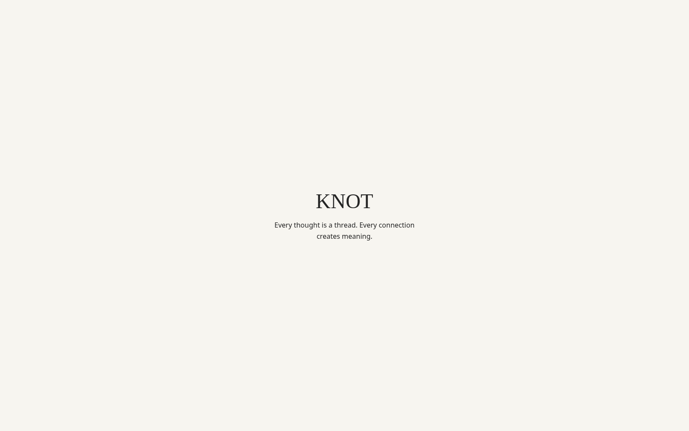
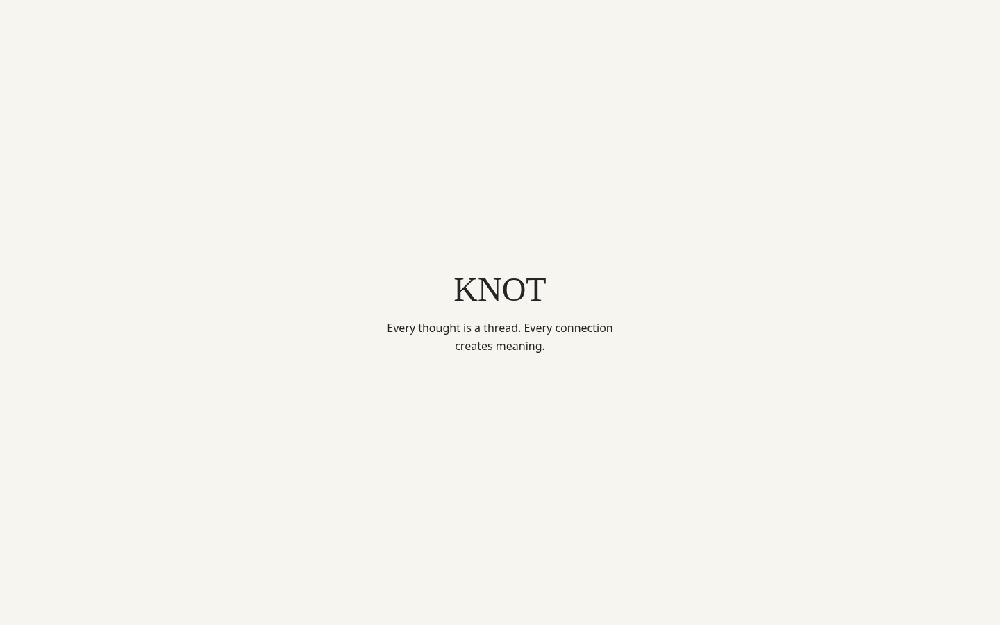

# Issue #1 — Design, architecture and Definition of Done

This review applies to the M0 desktop scaffold, using the binding
[design contract](../design/knot/README.md), [architecture](../architecture/TECH-STACK.md)
and [roadmap/Definition of Done](../PROJECT-ROADMAP.md). It does not complete
the entire M0 milestone or the future product screens and persistence features.

## Design and architecture review

| Requirement | Current implementation and evidence |
| --- | --- |
| Written visual contract | Warm ivory `#F7F5F0`, charcoal `#252525`, a restrained serif title, sans-serif interface and 16/32 px spacing. Used values live in [`tokens.css`](../../src/shared/styles/tokens.css). App selectors are scoped to `.app`; the title uses `rem` to follow base text-size preferences. |
| Fonts and assets | System font stacks with fallbacks; no external font downloads or redistributed font files. The KNOT icon is original SVG artwork. The original six product mockups are still missing, as recorded in the design contract. |
| Modular shared code | `app` composes the view, `shared` supplies CSS tokens, and feature/data ownership follows the [module rules](../../src/README.md). No Linux business APIs in the frontend; see the [portability review](PORTABILITY.md#m0-frontend-portability-verification). |
| Native shell and security | Tauri 2, pinned toolchains/lockfiles, explicit local capability with no granted native permissions, no custom IPC commands or plugins. Production startup and installation were [verified on CachyOS](CACHYOS.md#production-build-and-installation-result). |
| Real data and persistence | The view contains only the product name and tagline. There are no fabricated notes, relationships, counters or saved-state claims. No product persistence exists yet; write/search/reopen, migrations and failure recovery must be tested with their actual features. |
| Scope and portability | Foundation work only. Native Linux startup is verified. Windows/macOS build jobs exist; their runtime behavior and installed-data workflows are not claimed as verified. |

## Reproduce the automated checks

Use the project Node/pnpm versions in a host terminal:

```sh
pnpm install --frozen-lockfile
pnpm test
pnpm exec playwright install chromium
pnpm test:ui
```

`pnpm test` runs five Vitest integration tests against the real Linux
prerequisite CLI, with isolated executable fixtures on PATH. They cover the
pnpm fallback without a shebang, missing WebKitGTK/JavaScriptCore, wrong or
missing pnpm and aggregated missing compiler/pkg-config errors. Fixture
executables exist only in temporary test directories and are removed afterward.
These Linux-specific tests skip on other OSes.

`pnpm test:ui` first type-checks and builds the production frontend, then runs
eight Playwright checks in Chromium at 1600×1000 and 1440×900. They cover the
accessible content tree and language, JavaScript/console failures, local-only
resource loading, axe WCAG 2 A/AA and 2.1 A/AA checks, reduced-motion mode,
200% base text size at the 960×640 minimum window size and screenshot capture.
This is browser testing of built frontend assets, separate from native Tauri
startup and WebView testing.

The initial view has no interactive controls, navigation or app shortcuts.
There is no app keyboard workflow or focus cycle to test yet; do not add dummy
controls to create one. The document has an English language declaration, a
`main` landmark and a level-one heading exposed in its accessibility tree.
Automated checks do not replace a manual screenreader assessment of WebKitGTK.

The [CI workflow](../../.github/workflows/desktop-build.yml) includes these
Foundation checks alongside the three native build jobs. Its first remote
run after these changes remains pending.

## Screenshots for review

These are actual Chromium captures of the built launch view at 100% text size
and device scale 1, reviewed on CachyOS. They show frontend content, without a
native frame. They are review evidence, not automated image-diff baselines and
not substitutes for the missing original product mockups.

| 1600×1000 | 1440×900 |
| --- | --- |
|  |  |

Screenshots from a new `pnpm test:ui` run are written to ignored
`test-results/` directories, one per test/project. Copy the two reviewed
`launch.png` files to the paths above when changing this view. Update both
sizes together and include this evidence in the PR description.

## Recorded result and remaining review

Verified on 2026-11-12: five CLI integration tests and eight UI checks passed,
including the frontend TypeScript/build checks. Both screenshots were visually
reviewed. Workflow syntax was checked with actionlint.
The updated native production executable also compiled successfully using
`pnpm build --no-bundle -- --locked`; the installed AppImage startup evidence
in the Linux guide refers to the earlier installation check.

### Dependency checks

`pnpm audit --prod` and the full `pnpm audit` including development dependencies
reported zero known advisories on 2026-11-12. Direct dependency license metadata is recorded
in the [portability guide](PORTABILITY.md); this is not a complete transitive
license audit.

RustSec `cargo-audit` 0.23.0 checked the locked Rust dependency graph against
database commit `af7b3ec33460b8e2de8d422e16d628518891a519`. Its vulnerability
count was zero, but it reported these two informational findings, which remain
open for dependency follow-up:

| Locked package | Finding and dependency path |
| --- | --- |
| `glib` 0.18.5 | [RUSTSEC-2024-0429](https://rustsec.org/advisories/RUSTSEC-2024-0429.html): unsound `VariantStrIter` methods can cause undefined behavior/crashes. The advisory lists a fix in glib >=0.20. Tauri's GTK 3 stack uses `gtk` 0.18, whose manifest requires `glib` 0.18, so forcing a newer direct dependency would not replace the affected transitive one. Track a compatible upstream update or reviewed backport; reachability in the native dependency stack has not been established. |
| `proc-macro-error` 1.0.4 | [RUSTSEC-2024-0370](https://rustsec.org/advisories/RUSTSEC-2024-0370.html): unmaintained build-time dependency, pulled in by `glib-macros` and `gtk3-macros`. The advisory lists no patched version. |

No advisory ignore rules or native dependency overrides were added. A zero
exit status from cargo-audit does not resolve these findings. To reproduce:

```sh
cargo install cargo-audit --version 0.23.0 --locked --root node_modules/.cache/knot-audit
./node_modules/.cache/knot-audit/bin/cargo-audit audit --file src-tauri/Cargo.lock
```

- [x] Design and module boundaries reviewed for the current scaffold.
- [x] Relevant scaffold failure states have reproducible regression tests.
- [x] Semantic structure, automated accessibility, reduced motion and text resizing checked.
- [x] No fake product data or fake persistence in the current release path.
- [x] Screenshots at both required reference sizes prepared for review.
- [ ] Manual screenreader assessment in the native Linux WebView.
- [ ] Native KDE focus/window controls and HiDPI at 125% and 150%.
- [ ] Resolve or explicitly review the two transitive RustSec findings above.
- [ ] Remote CI results, PR with screenshots and human review/merge.

Empty/loading/write-failure/recovery states belong to the features that
introduce loading and persistence. They are not simulated in the production
scaffold. Recheck the installed release whenever runtime behavior changes.
